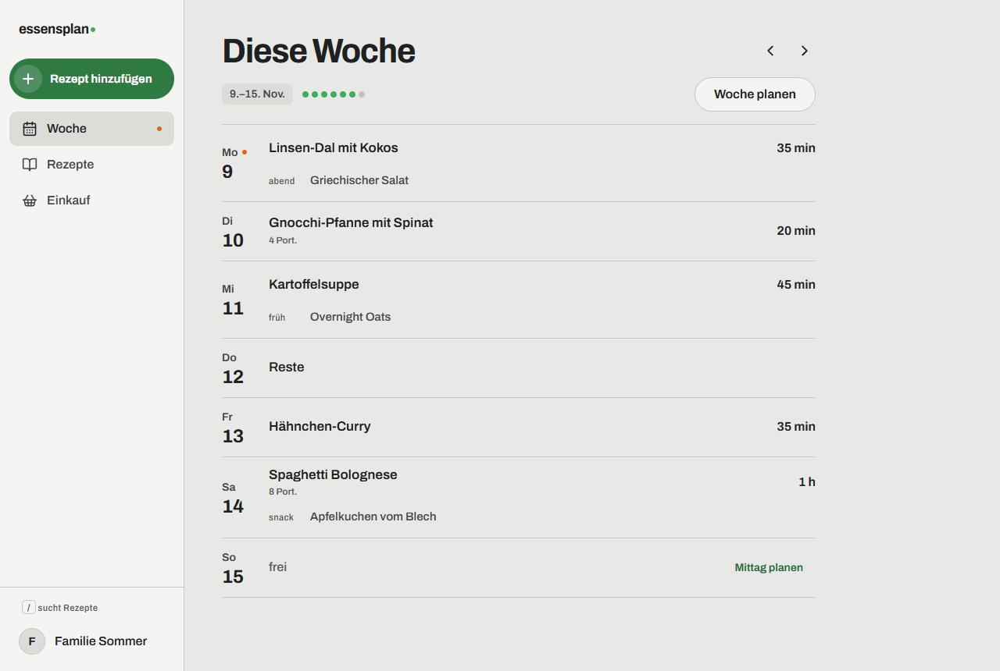
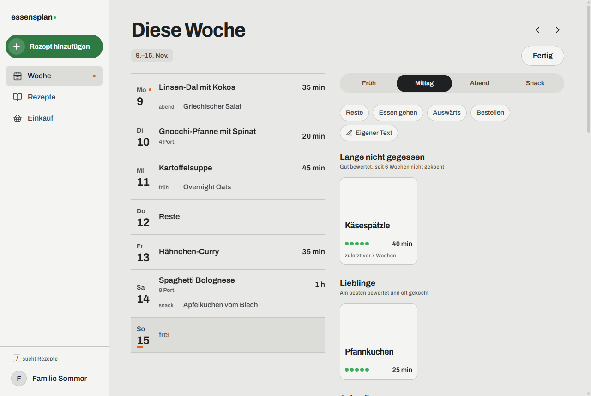
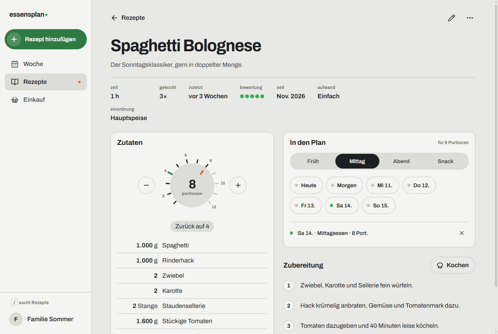
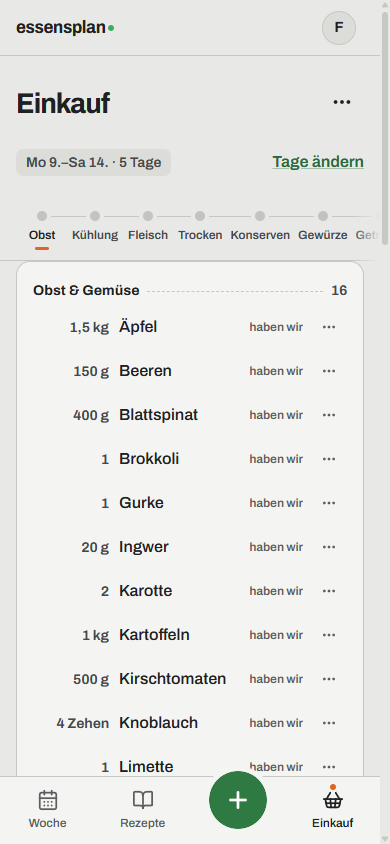
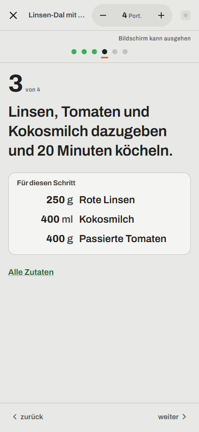

# Essensplan – Familien-Essensplaner

Das eigene Kochbuch und der Essensplan der Familie: Rezepte sammeln, die Woche planen, aus dem Plan einkaufen und kochen. Selbst gehostet, für eine Familie gebaut.



## So sieht es aus

<table>
  <tr>
    <td width="50%"></td>
    <td width="50%"></td>
  </tr>
  <tr>
    <td><b>Woche planen.</b> Ein Tipp trägt ein, dann geht es zum nächsten freien Tag. Vorschläge sagen, warum: lange nicht gegessen, Lieblinge, schnell.</td>
    <td><b>Rezept.</b> Der Portionsregler rechnet alle Mengen um. Wer so plant, plant gleich für diese Portionen; die Einkaufsliste rechnet mit.</td>
  </tr>
</table>

<table>
  <tr>
    <td width="50%" align="center"></td>
    <td width="50%" align="center"></td>
  </tr>
  <tr>
    <td><b>Einkauf.</b> Die Liste ergibt sich aus dem Plan, zusammengezählt und in der Reihenfolge deines Ladens. „haben wir“ merkt sich, was meist da ist.</td>
    <td><b>Kochmodus.</b> Ein Schritt pro Bildschirm, groß genug für die Arbeitsplatte, mit den Zutaten genau für diesen Schritt.</td>
  </tr>
</table>

<sub>Screenshots mit Beispieldaten.</sub>

## Funktionen

- **Rezepte:** die eigene Sammlung mit Zutaten, Schritten, Foto, Kategorie, Tags, Bewertung und Kochstatistik. Suche nach Titel und Zutat, Filter und Sortierung.
- **KI-Import (optional):** ein Link oder ein Foto (Website, Kochbuchseite, Screenshot) wird zum Rezeptentwurf, den du vor dem Speichern prüfst. Anbieter: OpenCode Go, Anthropic oder OpenAI. Ohne API-Schlüssel ist der Import aus und die App bietet nur „selbst eingeben“; sind mehrere eingerichtet, wählt jede Familie ihren unter Konto.
- **Wochenplan:** Frühstück, Mittagessen, Abendessen und Snack, mehrere Gerichte pro Mahlzeit. Vorschläge aus der eigenen Geschichte: lange nicht gekocht, Lieblinge, schnell gemacht. Bei Bedarf kocht ein Eintrag für andere Portionen als das Rezept (z. B. „8 Port.“, wenn Besuch kommt).
- **Einkauf:** die Liste ergibt sich aus dem Plan, sortiert nach Bereichen im Laden, mit eigenen Einträgen. Abweichende Portionen im Plan werden mitgerechnet.
- **Kochmodus:** Schritt für Schritt, mit den passenden Zutaten pro Schritt.
- **Geräte:** ein Login für die Familie. Neue Geräte werden per Code oder QR-Code gekoppelt.
- **Agenten:** REST-API (`/api/v1`) und MCP-Server (`/mcp`) mit eigenen, eingeschränkten API-Schlüsseln. Was ein Agent ändert, steht im Verlauf und lässt sich rückgängig machen.

## Technik

- **Backend:** PHP 8.2, Slim 4, PDO mit MySQL 8 (`src/`, `migrations/`, `bin/console`)
- **Frontend:** React 18 und TypeScript als Single-Page-App mit Vite (`frontend/`), gebaut nach `public/app`
- **Hosting:** all-inkl Webspace, Deploy per SSH mit `./deploy.sh`

## Agenten verbinden

In der App unter **Konto → API & Agenten** einen Schlüssel anlegen, dann den angezeigten Befehl ausführen, z. B. für Claude Code:

```sh
claude mcp add --transport http essensplan https://<deine-domain>/mcp --header "Authorization: Bearer esp_…"
```

Claude Desktop, Cursor, VS Code, Rechte und Fehlersuche: [docs/MCP.md](docs/MCP.md).

## Lokal entwickeln

Voraussetzungen: eine „Local“-Site `essen` (nginx, PHP 8.2, MySQL 8, Mailpit) mit dem Repo-Ordner `public/` als Docroot, Node 20+. Schritt für Schritt: [docs/DEVELOPMENT.md](docs/DEVELOPMENT.md).

```sh
composer install
cp .env.example .env               # APP_SECRET und Datenbank-Port der Local-Site eintragen
php bin/console migrate            # legt die Datenbank an
php bin/console user:create --email=du@familie.de --name=Familie --password=…

cd frontend && npm install
npm run dev                        # http://localhost:5173, API über http://essen.local
npm run build                      # baut die SPA nach public/app (dann http://essen.local)
```

Rechnerspezifische Pfade und Ports gehören in `LOCAL.md` (nicht im Repo), Einstellungen in `.env`.

Tests und statische Prüfung (brauchen MySQL, die Tests legen ihre eigene Datenbank an):

```sh
vendor/bin/phpunit
vendor/bin/phpstan analyse
cd frontend && npm run typecheck
```

## Deploy

```sh
./deploy.sh                        # bauen, per SSH austauschen, migrieren
./deploy.sh --console user:list    # beliebiger bin/console-Befehl auf dem Server
```

Einrichtung und Details: [docs/DEPLOY.md](docs/DEPLOY.md).

## Dokumentation

- [PRODUCT.md](PRODUCT.md): für wen und wozu
- [DESIGN.md](DESIGN.md): das visuelle System
- [docs/BACKEND.md](docs/BACKEND.md): Datenmodell, Endpunkte, MCP-Server, Konsole, Konfiguration
- [docs/MCP.md](docs/MCP.md): KI-Agenten verbinden
- [docs/DEVELOPMENT.md](docs/DEVELOPMENT.md): lokal entwickeln und testen
- [docs/DEPLOY.md](docs/DEPLOY.md): Einrichtung auf all-inkl und Updates
- [docs/DECISIONS.md](docs/DECISIONS.md): die Entscheidungen D1–D25
- [TODO.md](TODO.md): was noch offen ist

---

**Coded with ❤️ in THE LÄND.**
